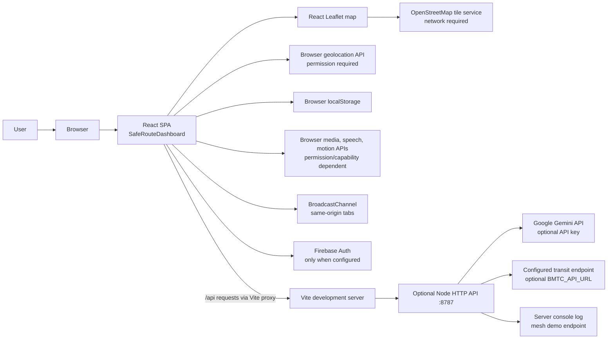
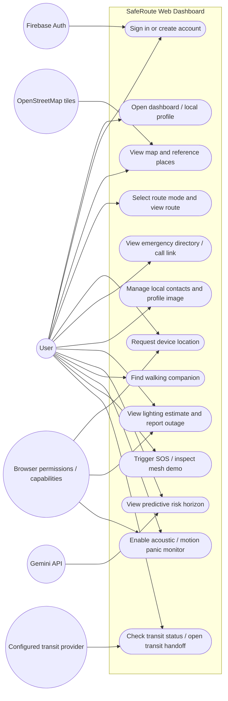
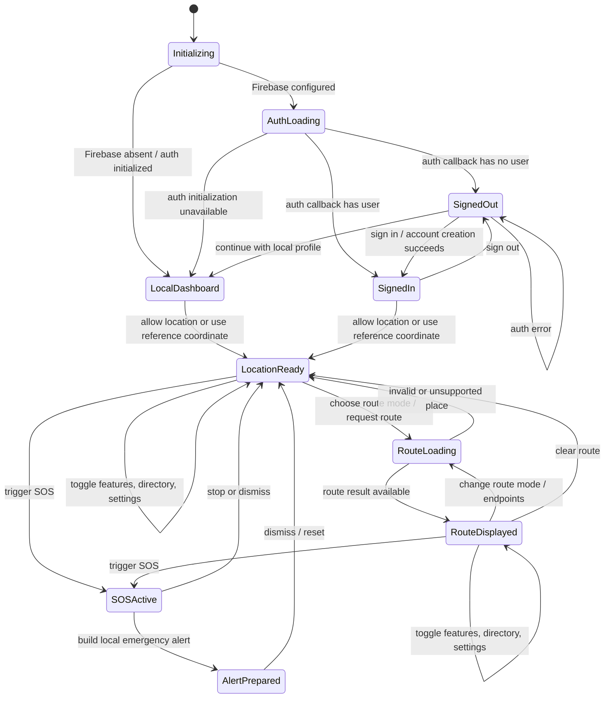
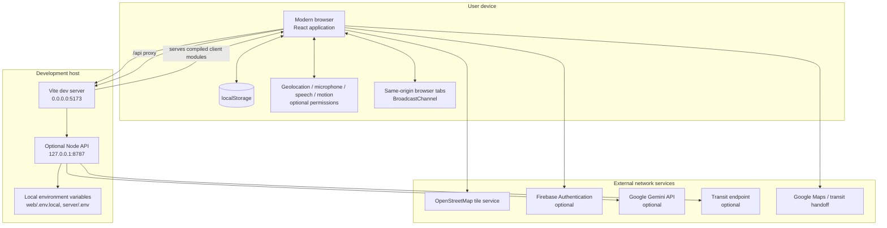
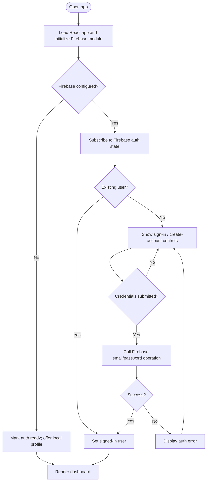
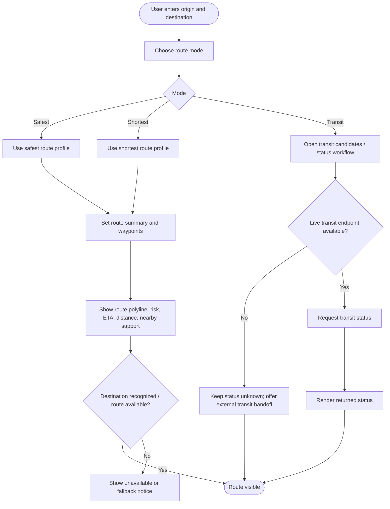
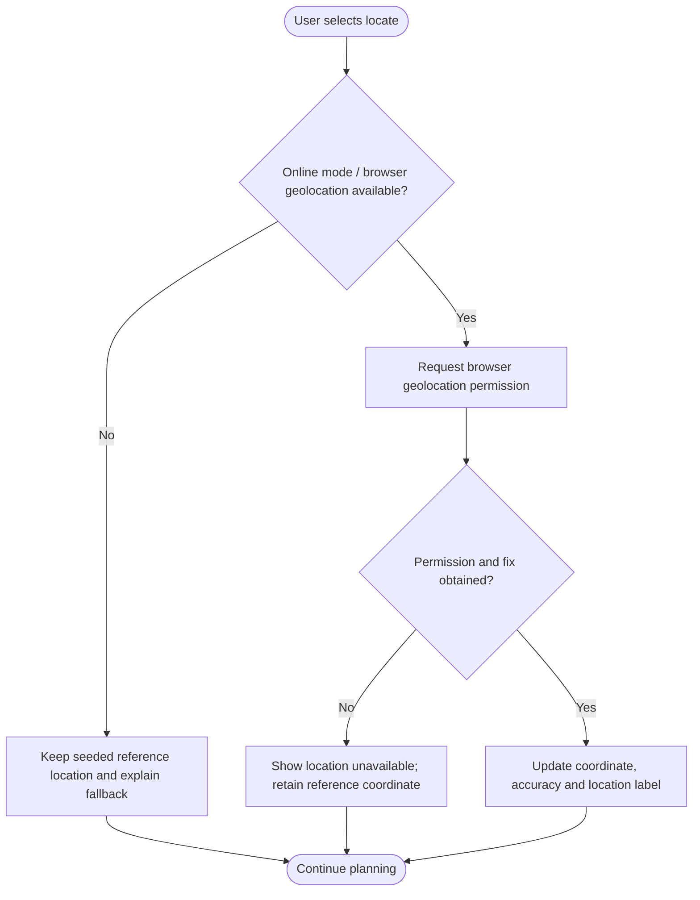
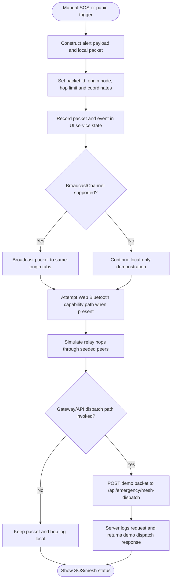
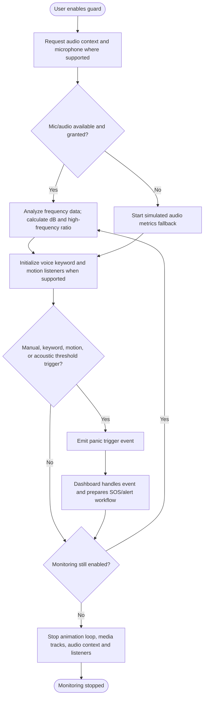

# SafeRoute Web Dashboard — System Design

This document describes the **React web dashboard** in `web/` and its optional Node API in `server/`. It does not describe the separate JavaFX prototype.

## 1. Scope and implementation status

The web client is a Vite + React + TypeScript single-page application. It presents route planning, a map, emergency contacts, profile/authentication controls, lighting and predictive-risk overlays, companion matching, acoustic panic monitoring, and Guardian Mesh demonstrations.

The dashboard combines implemented browser-side behavior with seeded demonstration data. Features that look like live safety services must not be treated as authoritative: route profiles, many directory coordinates, outage examples, companion candidates, mesh relay peers, and several temporal events are static or simulated. Browser capabilities and optional server credentials can also be unavailable. Emergency dispatch, production authentication, authoritative routing, live transit, and real Bluetooth mesh relaying are not established by this prototype.

## 2. System architecture



### Runtime components

| Component | Responsibility | Data / dependencies |
|---|---|---|
| `web/src/SafeRouteDashboard.tsx` | Main dashboard state and user workflows: route selection, SOS, emergency directory, auth UI, geolocation, transit, contacts, map display, feature panels | Seeded route profiles and reference points; browser APIs; imports feature services |
| `web/src/features/illumination/` | Computes a light estimate per point from solar/lunar values, segment type and outage reports; stores reports locally | `localStorage` key `saferoute-streetlight-outages`; astronomy calculations; sample outage if no saved value |
| `web/src/features/predictiveRisk/` | Computes time-of-day risk multiplier and event deltas; optionally requests an analysis summary | Local time/events; `POST /api/risk/predictive-horizon` is best-effort |
| `web/src/features/acousticPanic/` | Starts/stops audio analysis, speech keyword and motion monitoring when available; emits trigger events and optional audio clip | Microphone permission, Web Audio, speech recognition, device motion; simulated metrics fallback |
| `web/src/features/guardianMesh/` | Creates SOS packet, logs hops, shares packet across same-origin tabs, attempts a browser Bluetooth capability path | `BroadcastChannel`; peer/hop simulation; browser Bluetooth availability; API dispatch endpoint may be used by UI |
| `web/src/features/companionMatching/` | Generates a short token, displays sample companion candidates and shares panic notification between tabs | Static candidate list; Web Crypto when available; `BroadcastChannel` |
| `web/src/features/arCorridor/` | Displays the AR corridor HUD experience | UI demonstration; not a native AR navigation runtime |
| `web/src/firebase.ts` | Initializes Firebase only when configuration is present | `web/.env.local` values, based on `.env.example` |
| `server/index.mjs` | Optional JSON HTTP endpoints for route brief, predictive summary, mesh demo dispatch, and transit status | Node.js; optional Gemini key and transit endpoint |
| `web/vite.config.ts` | Proxies `/api` requests to `http://127.0.0.1:8787` while developing | Vite development server and Node API running locally |

### Data boundaries

- Route selection and most dashboard calculations run in the browser. The web dashboard's route profiles are seeded fallback objects; the Node `/api/gemini/route-summary` endpoint is a text brief and does not calculate a navigable route.
- The browser persists some user-created preferences and reports in `localStorage`; this storage is per browser profile and is not a synchronized account database.
- Firebase email/password authentication is conditional on valid client configuration. A local profile path is available when Firebase is not configured.
- Leaflet obtains map tiles from OpenStreetMap over the network. Offline routing data and offline map tiles are not equivalent; the web map requires network access for its tile layer.
- The Node API is optional. The client catches unavailable predictive API calls and computes a local baseline. Transit may remain `unknown` when no endpoint is configured.
- Gemini calls are made by the server so the API key is not embedded in the browser bundle. Never commit `.env` files or production secrets.

## 3. Use case diagram



## 4. Dashboard state chart

The chart captures the main dashboard's broad state. Feature modals and services have their own local state; they are summarized as substates here.



### Main state variables

The dashboard tracks route mode (`safest`, `shortest`, `transit`), current/reference coordinate, destination text, route visibility/loading, online/network indicators, SOS and alert flags, auth readiness/user/local-profile mode, map style, transit state, contact list, active directory filters, and per-feature modal/panel state. The acoustic service separately tracks monitoring and browser resource handles; mesh and companion services maintain their own packet/match state.

## 5. Deployment diagram



### Local development deployment

1. Install dependencies in `web/` with `npm install`.
2. Run `npm run dev -- --host 0.0.0.0` from `web/`; Vite serves the UI on port `5173`.
3. For API-backed features, configure `server/.env` from `server/.env.example`, then run `node server/index.mjs` from `server/` (default port `8787`). Vite proxies `/api` requests to it.
4. Configure Firebase client values in `web/.env.local` only when authentication is needed.
5. Browser access to microphone, location, and motion features depends on browser policy, permission, and usually a secure context such as localhost or HTTPS.

## 6. Flowcharts

### Flow 1 — Open dashboard and initialize authentication



### Flow 2 — Select and display a route



### Flow 3 — Request current location



### Flow 4 — SOS and Guardian Mesh demonstration



### Flow 5 — Acoustic panic monitoring



## 7. Feature workflows and persistence details

### Route and map

The dashboard stores route mode and active route summary in React component state. Its route options include distance, ETA, risk value, nearby support names, waypoints, alternatives and a source label. Leaflet renders the map and external tiles; route and place markers are overlaid by the client. Browser location requires user permission. Transit candidate values are seeded as unknown until an optional API response is available; a transit handoff may open an external maps service.

### Authentication and profile

When Firebase configuration exists, the dashboard subscribes to Firebase Auth state and offers email/password sign-in and account creation, plus sign-out. Without Firebase configuration it does not require an account and uses a local profile flow. Profile image and custom emergency contacts are stored in browser `localStorage`; they are not shared between devices.

### Emergency directory

The UI uses hard-coded emergency and nearby directory entries with names, phone numbers, categories, source labels and external source links. These are quick reference links. The prototype does not guarantee that the values are current, dispatch calls automatically, or verify which service covers a location.

### Lighting and outage reports

The lighting engine estimates light from solar/lunar calculations, road segment class, and stored outage reports. A sample outage is seeded if there is no saved entry. User outage reports and clears update `saferoute-streetlight-outages` in local storage. These are estimates and community reports, not a live municipal lighting feed.

### Predictive risk

The client applies a time-of-day multiplier and local event deltas, clamps calculated risk, and creates a recommendation. It best-effort posts origin, destination and time offset to `/api/risk/predictive-horizon`. The Node handler returns a baseline summary if no Gemini key is configured, or requests a Gemini summary if configured. A returned summary is advisory text and does not replace route computation or authoritative event data.

### Companion matching

The service can generate a corridor/time token with Web Crypto SHA-256 where available, but the displayed candidate list is seeded sample data. Companion panic uses `BroadcastChannel` to alert other compatible same-origin tabs; it does not contact a remote matching service or dispatch emergency responders.

### Acoustic guard

The acoustic service requests microphone access when possible, analyzes audio-frequency energy, and can use speech recognition and device motion where supported. It has a simulated metrics fallback when microphone access fails. Trigger heuristics and browser sensor signals are prototypes and may misclassify conditions. Stopping the guard releases microphone tracks, audio context and registered listeners.

### Guardian Mesh

The service constructs a packet, logs it, broadcasts to same-origin tabs, attempts a browser Bluetooth path when the API exists, and advances through seeded relay nodes as a simulation. `BroadcastChannel` only communicates between relevant same-origin contexts on the same device/browser profile; the code does not implement a real interoperable peer-to-peer mesh radio. The Node dispatch endpoint logs the request and returns a fabricated demo ticket/unit response; it is not connected to an emergency service.

## 8. Node API reference

The optional server listens on `PORT` or `8787`.

| Method and path | Purpose | Configuration / behavior |
|---|---|---|
| `POST /api/gemini/route-summary` | Generate a concise route safety brief | Returns `503` if `GEMINI_API_KEY` is absent; otherwise calls configured `GEMINI_MODEL` (default `gemini-2.0-flash`). This is narrative text, not routing. |
| `POST /api/risk/predictive-horizon` | Return predictive horizon summary | Without a key returns a local baseline; with key requests Gemini analysis and falls back to baseline on request failure. |
| `POST /api/emergency/mesh-dispatch` | Demonstration dispatch response | Logs packet/gateway details and returns a generated ticket and sample unit; no real dispatch occurs. |
| `GET /api/transit/bmtc?routes=...` | Query configured transit adapter | Without `BMTC_API_URL`, returns unknown statuses and an official app URL. With endpoint, forwards route list as JSON POST. |

All handlers return JSON and support basic CORS/OPTIONS. The API is a prototype service; add authentication, input validation, rate limits, controlled CORS, observability and operational safeguards before exposing it publicly.

## 9. Configuration and commands

```bash
cd web
npm install
npm run dev -- --host 0.0.0.0
```

Optional server:

```bash
cd server
# Configure server/.env using server/.env.example
node index.mjs
```

Vite proxies `/api` to `http://127.0.0.1:8787`. For non-development deployment, serve the built web assets from an HTTPS-capable static host and deploy the Node API separately with server-side secrets. Configure the API base/proxy for that deployment; do not expose Gemini secrets as client environment variables.

## 10. Operational constraints

- The map tile layer needs network access; the React dashboard is not a full offline map client.
- Browser geolocation, microphone, speech recognition, device motion and Bluetooth are optional browser capabilities and may require HTTPS and explicit permission.
- Local storage can be cleared, is device/browser-specific, and is not a backup or secure server-side store.
- Seeded locations, routes, events, support listings, companion records and mesh peers are demonstration content. Validate every real-world directory entry and geographic claim before operational use.
- The web dashboard and JavaFX app are separate implementations. This document covers only `web/` and `server/`.
